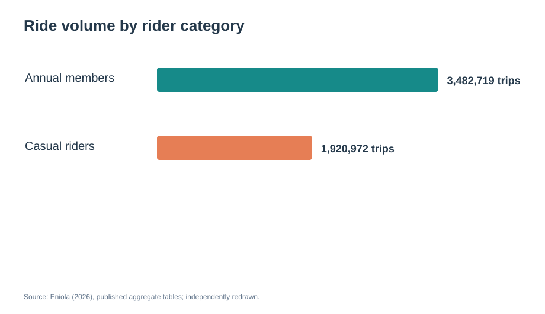
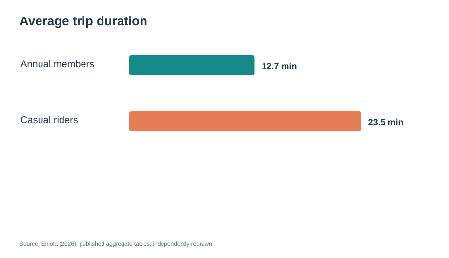
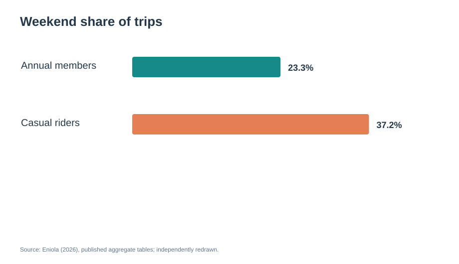
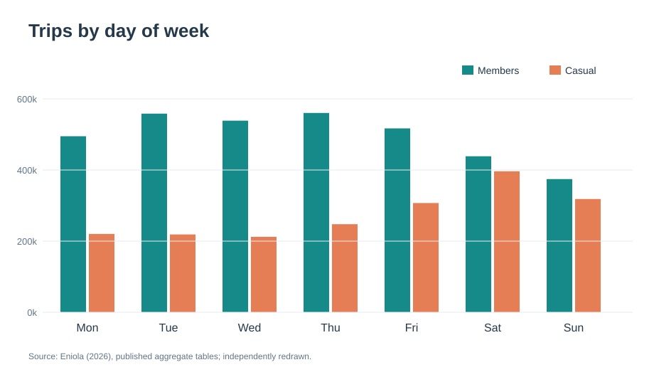
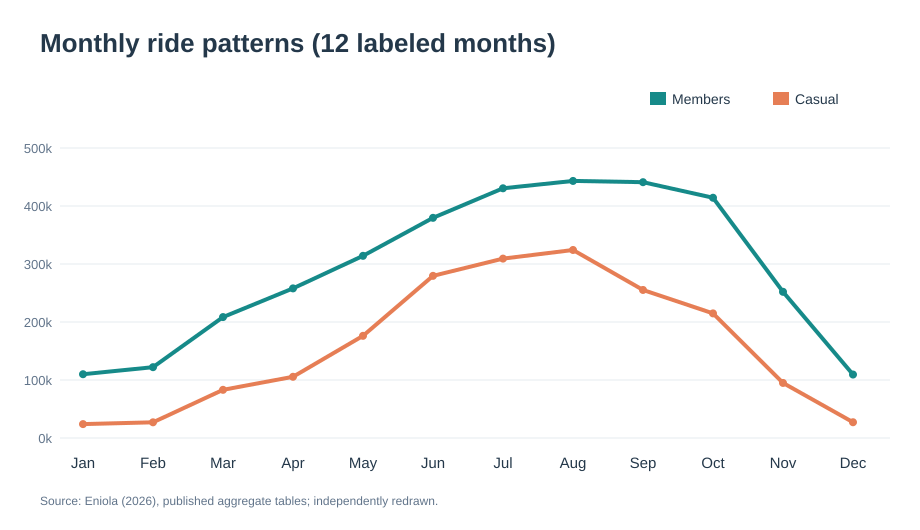

# دراسة حالة Cyclistic لمشاركة الدراجات

*مشروع Google Data Analytics Capstone — تحليل تعليمي ثانوي للبيانات المجمعة*

## الملخص التنفيذي
تُظهر الجداول المنشورة وجود **5,403,691 رحلة** بعد التنظيف، منها **3,482,719 رحلة (64.5%)** للمشتركين السنويين و**1,920,972 رحلة (35.5%)** للمستخدمين العاديين. بلغ متوسط مدة الرحلة **12.7 دقيقة** للأعضاء و**23.5 دقيقة** للمستخدمين العاديين. وشكلت رحلات عطلة نهاية الأسبوع **23.3%** و**37.2%** من إجمالي رحلات كل فئة على الترتيب.

**مهم:** أُعيد حساب بعض المؤشرات ورسم الأشكال من جداول مجمعة نشرها باحث آخر؛ لم تُحلَّل جميع ملفات الرحلات الخام بصورة مستقلة في هذا المشروع، وتوجد اختلافات في وصف تواريخ البيانات المصدرية.

## 1. اسأل (Ask)
**المشكلة:** كيف يختلف استخدام الدراجات بين المشتركين السنويين والمستخدمين العاديين؟ وكيف يمكن صياغة تجارب تسويقية لزيادة الاشتراكات؟
**أصحاب المصلحة:** مديرة التسويق ليلي مورينو وفريق التحليل والإدارة التنفيذية.

## 2. أعدّ (Prepare)
المصدر الأولي: [Divvy / Lyft](https://divvybikes-marketing.lyft.net/system-data).
المصدر التحليلي المستخدم: [دراسة Daniel Eniola المنشورة عام 2026](https://rstudio-pubs-static.s3.amazonaws.com/1411490_e71e5ba643c44e6ea9333d53b9b1b9e6.html).
وحدة التحليل هي **الرحلة**، وليست العميل الفريد.

## 3. عالج (Process)
أفاد الباحث الأصلي باستبعاد **148,401 رحلة** مدتها أقل من دقيقة من **5,552,092 رحلة**. لم يُكرر المشروع الحالي هذه الخطوة على الملفات الخام؛ وإنما أعاد حساب النسب والتجميعات من الجداول المنشورة، مع توثيق القيود المنهجية.

## 4. حلّل (Analyze)

| المؤشر | المشتركون السنويون | المستخدمون العاديون |
| --- | ---: | ---: |
| عدد الرحلات | 3,482,719 | 1,920,972 |
| نسبة الرحلات | 64.5% | 35.5% |
| متوسط مدة الرحلة | 12.7 دقيقة | 23.5 دقيقة |
| نسبة رحلات نهاية الأسبوع | 23.3% | 37.2% |
| نسبة رحلات يونيو–سبتمبر | 48.7% | 60.8% |

ترتفع مدة الرحلة للمستخدمين العاديين نسبيًا، وتتركز رحلاتهم أكثر في عطلة نهاية الأسبوع والموسم الصيفي. لا تكشف هذه الأنماط وحدها عن دوافع الأفراد أو احتمال تحولهم إلى اشتراك سنوي.

## 5. شارك (Share)

## 6. تصرف (Act): ثلاث توصيات قابلة للاختبار
1. **حملة نهاية الأسبوع:** تجربة A/B لرسالة توضح متى يصبح الاشتراك السنوي اقتصاديًا، باستخدام الأسعار الحقيقية.
2. **حملة ما قبل الصيف:** اختبار عرض موسمي محدود مقابل مجموعة ضابطة، وتقييم الاشتراكات والاحتفاظ بالعملاء والربحية.
3. **حملة الاستخدام اليومي:** اختبار رسائل الراحة والانتقال اليومي دون افتراض أن جميع المستخدمين العاديين يتنقلون إلى العمل.

هذه **مقترحات اختبار**، وليست نتائج مؤكدة عن أثر الحملات. وتحتاج الشركة إلى تحليل أولي للرحلات وتقييم تجريبي اقتصادي قبل تعميم استراتيجية التسويق.

## المراجع والقيود
[المصدر التحليلي المنشور](https://rstudio-pubs-static.s3.amazonaws.com/1411490_e71e5ba643c44e6ea9333d53b9b1b9e6.html) — [بيانات Divvy الأصلية](https://divvybikes-marketing.lyft.net/system-data) — [ترخيص البيانات](https://divvybikes.com/data-license-agreement).
راجع أيضًا [ملف توثيق المصدر](../documentation/PROVENANCE.md).
