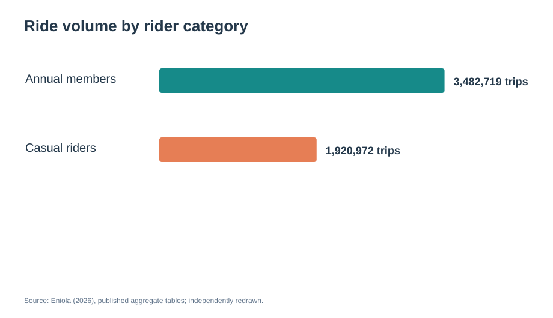
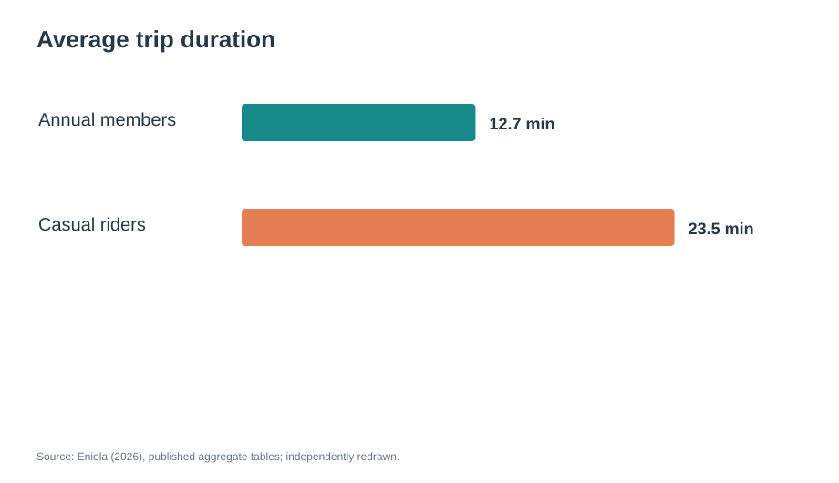
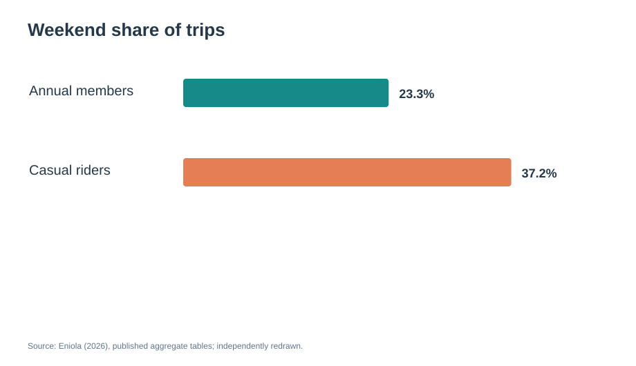
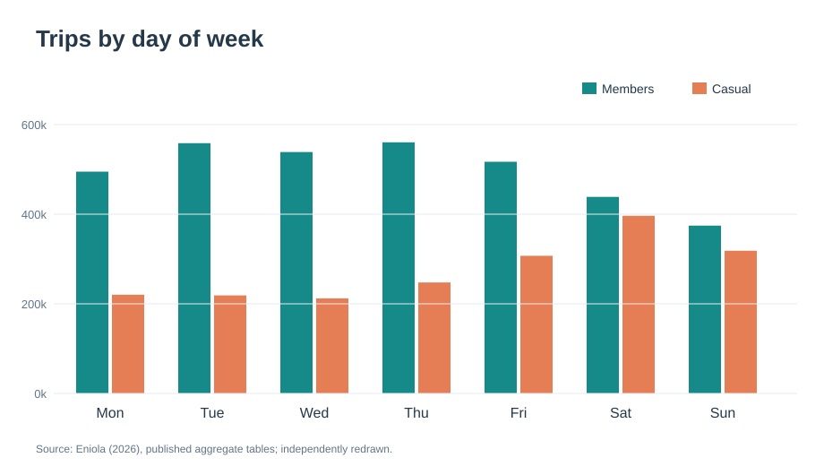
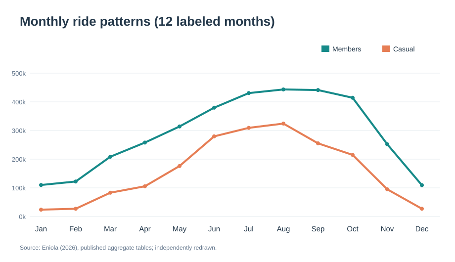

# Cyclistic Bike-Share — Case Study

*Google Data Analytics Capstone | Educational secondary-source analysis | November 2026*

## Executive summary
A published sample reports **5,403,691 valid rides**: **3,482,719 member trips (64.5%)** and **1,920,972 casual trips (35.5%)**. Casual journeys averaged **23.5 minutes** versus **12.7 minutes** for annual members. Saturday–Sunday trips represent **37.2%** of casual trips versus **23.3%** of member trips. These patterns are consistent with more leisure-oriented casual riding and more routine member travel, but do not prove individual intent.

**Evidence qualification:** This project recomputes visualizations from another analyst's published *aggregate tables*. It is not a newly conducted raw-trip study; exact 12-month coverage is unverified due to inconsistent descriptions in the published source.

## 1. Ask — Business task
**Question:** How do annual members and casual riders use Cyclistic bikes differently, and what low-risk marketing experiments could improve subscription conversion?

**Stakeholders:** Marketing director Lily Moreno, marketing analytics team, executive decision-makers.

## 2. Prepare — Data sources
- Original data provider: [Divvy / Lyft](https://divvybikes-marketing.lyft.net/system-data)
- Aggregate source: [Daniel Eniola (2026)](https://rstudio-pubs-static.s3.amazonaws.com/1411490_e71e5ba643c44e6ea9333d53b9b1b9e6.html).
- Unit of analysis: **trips**, not unique riders. Aggregate counts are provided by member type, month and weekday, and average trip lengths by rider type.

## 3. Process — Data cleaning and quality
The original analyst reported filtering out 148,401 sub-minute rides from 5,552,092 input rows, producing 5,403,691 remaining journeys. We did not rerun this step on raw files. We checked and recalculated category totals and shares from the published aggregates. See [PROVENANCE](../documentation/PROVENANCE.md) for caveats and independent validation requirements.

## 4. Analyze — Results

| Metric | Annual members | Casual riders |
| --- | ---: | ---: |
| Trip count | 3,482,719 | 1,920,972 |
| Share of trips | 64.5% | 35.5% |
| Mean trip duration | 12.7 min | 23.5 min |
| Weekend share | 23.3% | 37.2% |
| June–September share | 48.7% | 60.8% |

Casual mean trip durations are about **1.85 times** member durations. Published weekday counts peak on **Thursday (560,394)** for members and **Saturday (396,411)** for casual riders. Both groups peak in August in the published monthly table.

## 5. Share — Visual evidence

## 6. Act — Three proposed controlled experiments
1. **Weekend membership messaging:** A/B-test a plan break-even message Thursday–Sunday using verified published prices. Track incremental memberships, net margin and campaign costs.
2. **Seasonal conversion campaign:** Test a spring offer before the June–September peak against a randomized control. Track sign-ups, 30/90-day retention and profit.
3. **Everyday-mobility message:** Test weekday plan-convenience messaging and optional fare comparisons. Do not infer all casual trips are work commutes.

These are **testable recommendations**, not demonstrated causal improvements.

## Limitations
The source has conflicting coverage descriptions; trips are not distinct customers; no individual-level conversion or revenue data were supplied. The company should not scale a marketing campaign without raw-file validation and controlled estimates of incremental profitability.

## References
- Eniola, D. (2026, March 1). [*Cyclistic Bike-Share Analysis*](https://rstudio-pubs-static.s3.amazonaws.com/1411490_e71e5ba643c44e6ea9333d53b9b1b9e6.html).
- [Divvy system data](https://divvybikes-marketing.lyft.net/system-data); [data license](https://divvybikes.com/data-license-agreement).
- Google Data Analytics Professional Certificate, *Cyclistic Case Study 1*.
